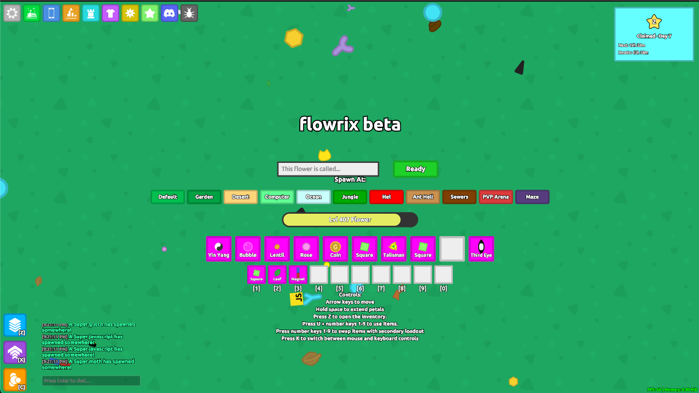

# florrclone-cpp 

Ashflor 的 C++/WASM 整端线：技术壳来自 flowrix（[`reference/florr_clone-web`](../reference/florr_clone-web)），游戏内容表将按现网 [`florrclone`](../florrclone) 对齐。分工与边界见 [ASHFLOR.md](ASHFLOR.md)。

上游 upstream：

[florr.io](https://florr.io) clone — [Public Server](https://florrclone.cryodome.com) — [Discord](https://discord.com/invite/SvAYCGsmAg)



> **License notice:** As of October 2026 this project is licensed under the
> [GNU Affero General Public License v3.0 or later](LICENSE) (previously GPL v3
> or later, and before that ISC), because it contains code adapted from gardn:
> [trigonal-bacon/gardn](https://github.com/trigonal-bacon/gardn)

## Local server

```powershell
npm run start_nobuild
```

打开 <http://localhost:3001>（与现网 JS 服端口错开）。

## License

Copyright (c) 2026 sussybite8888

This program is free software: you can redistribute it and/or modify it under
the terms of the GNU Affero General Public License as published by the Free
Software Foundation, either version 3 of the License, or (at your option) any
later version. See [LICENSE](LICENSE) for the full text.

This program is distributed in the hope that it will be useful, but WITHOUT
ANY WARRANTY; without even the implied warranty of MERCHANTABILITY or FITNESS
FOR A PARTICULAR PURPOSE. See the GNU Affero General Public License for more
details.
